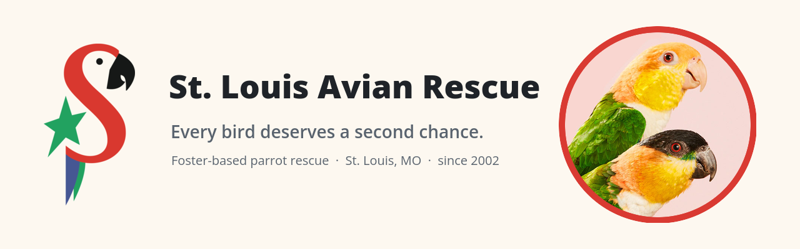

<picture>
  <source media="(prefers-color-scheme: dark)" srcset="banner-dark.png">
  
</picture>

  <b>STAR</b> is an all-volunteer, foster-based 501(c)(3) parrot rescue in St. Louis, Missouri, helping birds since 2002. 
  We rescue, rehabilitate, foster and rehome companion birds, and teach people how to care for them.

  <a href="https://staravian.org/adopt/">🏠 Adopt</a> ·
  <a href="https://staravian.org/foster/">🤝 Foster</a> ·
  <a href="https://staravian.org/donate/">💚 Donate</a> ·
  <a href="https://staravian.org/volunteer/">🙋 Volunteer</a> ·
  <a href="https://staravian.org/adopt/success-stories/">🎉 Success stories</a>

---

## 🛠️ The tech flock

Volunteers build and look after the tools that help STAR care for birds and find them homes. Any projects we share publicly will show up here.

## 🪶 Did you know?

- Large parrots like macaws and cockatoos can live **50 to 80+ years**, so adopting one can mean planning for a bird that outlives you.
- Parrots are flock animals. To your bird, you *are* the flock.
- Nonstick (PTFE/Teflon) cookware fumes can be deadly to birds. [Read why →](https://staravian.org/resources/teflon/)
- Weighing your bird regularly is one of the best early-warning signs of illness. [How to →](https://staravian.org/resources/weighyourbird/)

## 💌 Get involved

Know someone who could use a feathered friend, or have a few hours to share? Every foster home and volunteer helps another bird land somewhere safe and loved.

  <a href="https://staravian.org/donate/"><b>Support STAR 💚</b></a>

Made with 💚 and ☕ by STAR volunteers.

